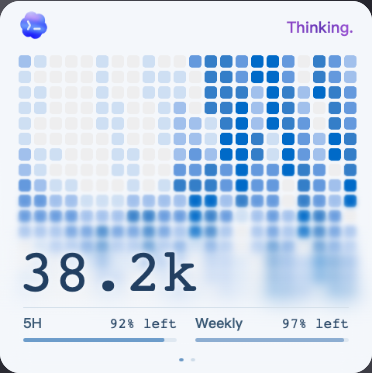
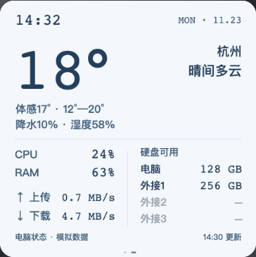
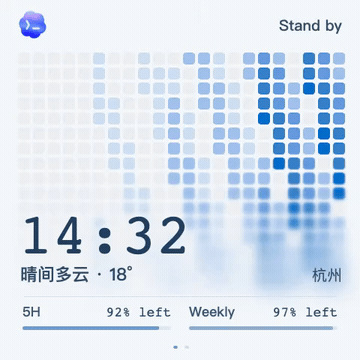
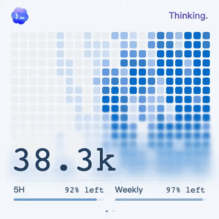
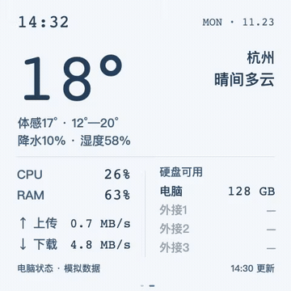

<div align="center">


# AI Desk Companion

**Bring your AI assistant’s activity to your desk.**

A desktop display UI prototype designed for a 480 × 480 touch screen.  
See when your assistant is working, waiting for you, or finished—alongside weather and computer activity.

**English** | [简体中文](README.zh-CN.md)

`Browser prototype` · `Pixel heatmap` · `Two-page layout` · `Offline preview`

[Animations](#animations) · [Quick start](#quick-start) · [Make it yours](#make-it-yours) · [Roadmap](#roadmap)

</div>

> **Project status:** This repository contains an offline browser UI prototype. Tokens, quotas, weather, computer metrics, disk connections, and transfers are simulated. ESP32 firmware and real data collectors are not included yet. You can explore every screen and animation without a development board.

## Preview

| 01 · Assistant activity | 02 · Weather and computer |
| :---: | :---: |
|  |  |
| State, usage, and quotas at a glance | Weather above, computer metrics below |

The default theme uses Codex artwork and some Chinese UI labels. The UI text and theme can be customized in the source.

## Why this exists

When an AI assistant works on my computer, I want to glance over and know: Is it still working? Is it waiting for me? Has this task finished?

This little display turns that activity into a blue pixel heatmap that gently expands while work is in progress. When idle, it returns to a clock and weather. A second page adds performance, network, and disk information to make it useful throughout the day.

The current focus is getting the interface and motion right, before connecting real data and hardware. You are welcome to suggest themes and adaptations for your own desk.

## Animations

### 1 · The complete assistant workflow

**Stand by → Thinking → Your turn → All set → Stand by**, followed by a short task that finishes after one second of running.

<p align="center"></p>

<p align="center"><a href="docs/demos/01-main-flow.mp4">Watch the smooth MP4 · 35 seconds</a></p>

### 2 · Page transitions and disk transfers

| Switching pages · 13 seconds | Disk connection and transfer · 33 seconds |
| :---: | :---: |
|  |  |
| Main screen exits → weather appears centrally → moves up → device details appear → return | Connect drives → read and write → overall progress → restore capacity view |
| [Watch MP4](docs/demos/02-page-transition.mp4) | [Watch MP4](docs/demos/03-disk-transfer.mp4) |

All recordings come directly from this prototype. MP4s are 480 × 480 at 30 fps with no audio. The soft two-note chime can be previewed in the interactive UI. Recordings shorten the completed-state hold to nine seconds; normal choices are two, three, or five minutes.

The disk demo also shows an indeterminate activity bar when the task total is unknown. Connecting a disk currently updates its slot directly; speed, progress, and the return to capacity view are demonstrated dynamically.

**Try it yourself:** Download the repository and open [the interactive prototype](index.html), or use [the video gallery](docs/showcase.html). GitHub’s file viewer does not execute these HTML pages; open them locally after downloading.

## Features

- **Weekly activity heatmap:** Blue shades represent simulated activity intensity. Idle mode retains the usage pattern; running mode adds gentle expansion and an increasing token count.
- **Four assistant states:** `Stand by`, `Thinking…`, `Your turn`, and `All set`. Thinking has a purple gradient and subtle icon motion.
- **Text transitions:** Outgoing content decodes away. Attention and completion screens introduce a greeting before moving it upward and revealing status text. Completion automatically returns to idle.
- **Weather-first second page:** Weather and time appear above compact CPU, RAM, upload, and download metrics. Four disk slots sit at the lower right.
- **Contextual disk information:** The source shows free space, the destination shows MB/s, and an idle connected slot shows simulated overall copy progress. Disconnected slots appear gray.
- **Soft chime and gradient blur:** Preview a two-note sound; a downward blur gradient supports readable text. The UI respects the system’s reduced-motion setting.

### Implementation status

| Component | Status |
| --- | --- |
| Two-page layout, heatmap, state and text animations | Implemented in the browser |
| Weather, metrics, quotas, and disk transfers | UI implemented with simulated data |
| Live Codex state, tokens, and quota | Data sources and semantics still need verification |
| Claude / Claude Code, WorkBuddy, or other themes | Editable in source; no built-in theme selector or live adapters |
| ESP32 firmware, flashing, and touch testing | Planned |

## Quick start

**No dependencies are required to view the prototype.** Download and extract the repository, then open `index.html` in a modern browser.

Alternatively, serve the repository locally:

```bash
python3 -m http.server 8000
```

Open <http://localhost:8000>.

Suggested walkthrough (the controls currently use Chinese labels):

1. Click **重播完整流程** to replay idle, running, attention, completion, and automatic return.
2. Click **快速完成** to test a short task.
3. Click **天气第二页**, or swipe horizontally on the main display.
4. Cycle the external disk count, then click **模拟复制任务** to simulate copying.
5. Click **仅监测读写** for unknown-total activity, and **试听** to hear the chime.

The preview makes no network requests, reads no actual system metrics, and needs no API key. Some preferences are saved in browser local storage; the preview still works if storage is unavailable.

## Make it yours

**Codex is the current theme, rather than a requirement for the design.** Ask a coding-capable AI assistant to change the icon, colors, state labels, and greeting for Claude / Claude Code, WorkBuddy, or your own assistant.

The Tencent product is spelled **WorkBuddy**; see its [official product page](https://cloud.tencent.com/product/workbuddy). For a Claude coding-assistant theme, **Claude Code** is an appropriate label.

| Customization | Where to change it |
| --- | --- |
| Icon | Supply a transparent PNG and update the embedded image data and drawing dimensions in `src/preview.html`. Replacing the file in `assets/` alone does not update the canvas icon |
| Colors, heatmap, background, typography | Drawing functions and colors in `src/preview.html` |
| State labels, greeting, and task messages | `labels`, `drawTop`, `drawStatus`, and related text |
| City, weather, disk names, capacities | Weather and device demo data |
| Live activity and usage | A separate adapter for the selected assistant, using verified interfaces, events, or logs |

Copy this prompt into your coding assistant:

```text
Read README.md and src/preview.html, then adapt the current Codex theme
for Claude Code (or WorkBuddy).

I will supply a transparent icon that I have permission to use.
1. Replace the embedded canvas icon; avoid white borders and stretching.
2. Adapt accent colors, state labels, and the greeting.
3. Preserve both pages, transitions, gradient blur, and disk demos.
4. Keep simulated data for now. Do not describe a theme change as a live integration.
5. Run python3 scripts/build_preview.py to regenerate index.html.
   Check all four states, short-task completion, page switching, and disk activity.
6. Before implementing live integration, identify verified data sources
   and any missing interfaces.
```

Changing appearance and connecting live data are separate steps. A new icon previews a new theme; following another assistant’s actual activity requires its state, token, or quota data. This repository does not yet provide live adapters for any assistant.

## Structure and development

```text
ai-desk-companion/
├── index.html                  # Standalone interactive preview
├── src/preview.html            # UI, drawing logic, and simulated data
├── scripts/build_preview.py    # Standard-library Python build script
├── assets/                     # Theme artwork and audio
├── docs/
│   ├── demos/                  # Three GIF and MP4 recordings
│   ├── images/                 # Screenshots
│   ├── showcase.html           # Local video gallery
│   └── README-preview.html     # Local README layout preview
├── README.md                   # English
└── README.zh-CN.md             # Simplified Chinese
```

After editing the source, regenerate the standalone page:

```bash
python3 scripts/build_preview.py
```

Building does not require Node.js or npm. Commit both the source and generated `index.html` so others can preview it immediately. Update screenshots and recordings when changing the theme.

## Target hardware and integration plan

The target is the [Waveshare ESP32-S3-Touch-AMOLED-2.16](https://docs.waveshare.com/ESP32-S3-Touch-AMOLED-2.16): a 2.16-inch, 480 × 480 touch AMOLED board with 16 MB Flash, 8 MB PSRAM, Wi-Fi, USB, and RTC resources. Hardware adaptation and testing are still pending.

Planned architecture:

```text
Assistant events / computer metrics → computer collector → USB or LAN → ESP32 UI
Weather API / network time ──────────────────────────────────────────→ ESP32
```

This is a proposed architecture; only the browser prototype exists today. The device would store firmware, artwork, and settings and draw the interface locally while the computer sends state data. Frame rate, blur implementation, and memory use need testing on the actual board.

<details>
<summary>Data sources and disk progress limitations</summary>

| Data | Proposed source | Current limitation |
| --- | --- | --- |
| Assistant state, tokens, quotas | Available APIs, events, or local logs | Unverified; each assistant needs its own adapter |
| CPU, RAM, network, disk I/O | Computer collector, roughly once per second | Not implemented |
| Disk space and connections | Volume and filesystem information | Physical disk counters must be mapped to volumes correctly on macOS |
| Exact copy percentage | A task with known total and completed bytes | Raw disk I/O cannot identify one task’s progress |
| Weather | Device requests to a weather API, potentially Open-Meteo | City, connectivity, and availability need testing |
| Time | Network synchronization and onboard RTC | Offline accuracy and power-loss retention need testing |

Caching, background I/O, and parallel tasks affect disk speed. Without a known task total, show activity and unknown progress rather than inventing a percentage.

References: [psutil](https://psutil.readthedocs.io/stable/), [Apple Progress](https://developer.apple.com/documentation/foundation/progress), [Open-Meteo](https://open-meteo.com/en/docs).

</details>

## Roadmap

- [x] Two-page layout, blue heatmap, and state animation prototype.
- [x] GIF / MP4 recordings of states, page transitions, and disk activity.
- [x] Offline preview and theme customization guide.
- [ ] Verify Codex state, token, and quota sources and reporting semantics.
- [ ] Build a computer collector for performance, network, and disks.
- [ ] Implement ESP32 display, touch, communication, and firmware support.
- [ ] Add weather, time synchronization, and offline behavior.
- [ ] Support trackable copy tasks and disk hot-plug events.
- [ ] Add adapters and theme configuration for other AI assistants.

## Feedback and contributions

Suggestions, theme experiments, layout improvements, and adaptation reports are welcome.

For visual issues, include your browser, reproduction steps, expected behavior, and a screenshot or recording. Before submitting changes, check all four states, short tasks, page switching, and disk demos. For live integrations, describe the data source and any unsupported cases.

## References and thanks

README organization was informed by these related projects:

- [Pixel Agents ESP32](https://github.com/underactive/pixel-agents-esp32): hardware, architecture, project structure, and customization documentation.
- [Agent Buddy](https://github.com/DanWahlin/agent-buddy): previews, quick start, state descriptions, and customization.
- [usage-display](https://github.com/bdw547/usage-display): usage display and collection architecture documentation.

These are documentation references, not a claim that this prototype includes their firmware, collectors, or supported integrations. No code or assets from those projects were introduced during this documentation update.

## License and branding

No code license has been selected yet. A `LICENSE` file will be added once one is chosen; making a repository public does not by itself grant an open-source license.

This is an unofficial personal prototype. Codex, Claude, WorkBuddy, and their marks belong to their respective owners. The icon was prepared from a user-supplied reference; brand assets are not licensed through the project’s code. This project is not officially affiliated with OpenAI, Anthropic, Tencent, or Waveshare.
