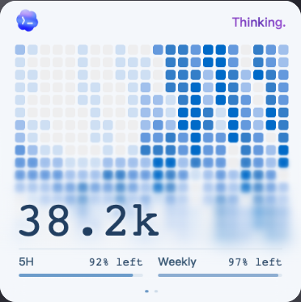
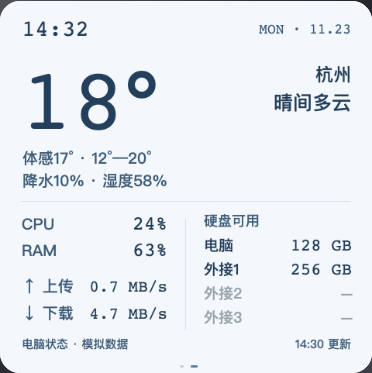
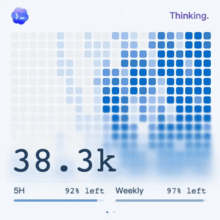
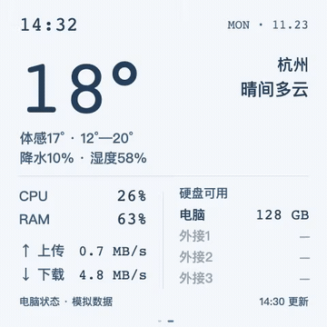

<div align="center">


# AI Desk Companion · AI 桌面助手

[English](README.md) | **简体中文**

**把 AI 的工作状态，放到桌面上。**

一个为 480 × 480 触摸小屏设计的桌面状态屏原型。  
看它运行、等你回应、完成任务，也看看窗外天气和电脑状态。

`浏览器交互原型` · `蓝阶像素方阵` · `双页布局` · `离线可预览`

[动画演示](#动画演示) · [快速开始](#快速开始) · [换成你的 AI 助手](#换成你的-ai-助手) · [开发计划](#开发计划)

</div>

> **项目进度**：当前提供可离线运行的浏览器交互原型。Token、额度、天气、电脑指标和磁盘任务均为模拟数据；ESP32 固件与真实数据采集尚未接入。不需要开发板，也可以先体验全部页面和动画。

## 界面预览

| 01 · AI 状态与用量 | 02 · 天气与电脑状态 |
| :---: | :---: |
|  |  |
| 状态、用量、额度，一眼看清 | 天气在上，设备信息在下 |

## 为什么做这个

AI 在电脑里工作时，我想抬眼就知道：它还在跑吗？是不是在等我？这一轮做完了吗？

于是有了这个小屏幕：工作时展示会扩散的蓝色像素方阵；空闲时回到时钟和天气。第二页放上电脑性能、网络与磁盘信息，让它也能成为日常桌面的一个小仪表盘。

现在先把界面和动画做好，再逐步接上真实数据与开发板。欢迎把它改成适合自己桌面的样子。

## 动画演示

### 1 · 第一页完整状态流程

**待机 → Thinking → 等你处理 → 完成 → 回到待机**，并补充“运行 1 秒即完成”的短任务。

<p align="center"></p>

<p align="center"><a href="docs/demos/01-main-flow.mp4">观看清晰流畅的 MP4 · 35 秒</a></p>

### 2 · 页面切换与磁盘传输

| 双页切换 · 13 秒 | 硬盘连接与读写 · 33 秒 |
| :---: | :---: |
|  |  |
| 主屏解码退场 → 天气居中出现 → 上移展开设备信息 → 返回主屏 | 连接外接盘 → 读出与写入 → 总进度 → 完成后恢复容量 |
| [查看 MP4](docs/demos/02-page-transition.mp4) | [查看 MP4](docs/demos/03-disk-transfer.mp4) |

三段动画均录制自当前原型。MP4 为 480 × 480、30 fps，无配音；轻柔双音可在交互界面中试听。为便于观看，演示里的完成停留缩短为 9 秒；正常设置为 2 / 3 / 5 分钟。

硬盘演示也包含无法确定任务总量时的“进度未知”活动条。热插拔当前直接更新槽位，传输速度、进度条与完成后的容量恢复具有动态效果。

**想自己操作？** 下载仓库后打开 [交互原型](index.html)；只想看视频，可以打开 [动画展厅](docs/showcase.html)。GitHub 文件页不会直接运行 HTML，需下载后用浏览器打开。

## 可以看到什么

- **一周用量的像素方阵**：同一蓝色系用深浅表示活动强度；待机保留使用痕迹，运行时缓慢扩散，模拟 Token 数字持续增长。
- **四种工作状态**：`Stand by`、`Thinking…`、`Your turn`、`All set`。Thinking 使用紫色渐变，云朵图标有轻微动态。
- **自然的文字转场**：旧内容解码离场，处理与完成页先问候、再上移展开文字；完成后自动回到待机。
- **天气优先的第二页**：天气与时间放在上方，CPU、RAM、上传和下载紧凑排列，右下保留电脑盘和三个外接盘槽位。
- **有区分的磁盘显示**：读出盘显示可用空间，写入盘显示 MB/s，空闲且已连接的槽位显示模拟任务总进度；未连接显示灰色。
- **轻柔双音与渐变模糊**：提示音可试听，下方渐变模糊衬托文字，并尊重系统的减少动态效果设置。

### 当前完成到哪一步

| 部分 | 当前状态 |
| --- | --- |
| 双页布局、像素方阵、文字动画与状态演示 | 已实现，可在浏览器体验 |
| 天气、性能、网络、额度与磁盘传输 | 已完成界面，使用模拟数据 |
| Codex 真实状态、Token 与额度 | 数据来源与统计口径待验证 |
| Claude / Claude Code、WorkBuddy 等主题 | 可修改源码定制，未提供预置切换器或真实适配器 |
| ESP32 固件、烧录与触摸实机测试 | 待开发 |

## 快速开始

**只看效果，无需安装依赖。** 下载并解压仓库，使用现代浏览器打开 `index.html`。

也可以在仓库目录启动本地服务：

```bash
python3 -m http.server 8000
```

打开 <http://localhost:8000>。

建议按这个顺序试一遍：

1. 点击“重播完整流程”，看待机、运行、等你处理、完成与自动回待机。
2. 点击“快速完成”，检查短任务的动画。
3. 点击“天气第二页”，或在主屏上左右滑动。
4. 切换外接盘连接数，再点击“模拟复制任务”。
5. 点击“仅监测读写”，比较未知总进度的显示；点击“试听”听轻柔双音。

原型在本地运行，不请求网络、不读取真实电脑指标，也不需要 API Key。部分偏好保存在浏览器本地存储中；存储不可用时仍可预览。

## 换成你的 AI 助手

**不只可以做 Codex 主题。** 你可以把项目交给能编辑代码的 AI 助手，请它帮你替换图标、颜色、状态文案和问候语，做成 Claude / Claude Code、WorkBuddy，或自己的桌面助手主题。

WorkBuddy 的名称拼写为 **WorkBuddy**，可参考[腾讯官方产品页](https://cloud.tencent.com/product/workbuddy)。如果想做 Claude 的编程助手主题，文案可写作 **Claude Code**。

| 想改什么 | 从哪里改 |
| --- | --- |
| 图标 | 准备透明 PNG；更新 `src/preview.html` 内图标的嵌入数据与绘制尺寸。单独替换 `assets/` 文件不会自动更新画布图标 |
| 颜色、像素方阵、背景与文字 | 修改 `src/preview.html` 中的绘制逻辑和颜色 |
| 状态词、问候语与任务提示 | 修改 `labels`、`drawTop`、`drawStatus` 等对应文案 |
| 城市、天气、设备名称与容量 | 修改天气和设备演示数据 |
| 真实状态与用量 | 另行实现所选助手的数据适配；先验证可用接口、事件或日志 |

可以直接把下面这段话交给 AI：

```text
请先阅读这个项目的 README.md 和 src/preview.html，
把当前 Codex 主题改成 Claude Code 主题（也可以替换成 WorkBuddy）。

我会提供一张有权使用的透明背景图标：
1. 替换画布里嵌入的图标，并调整尺寸，避免白底和拉伸。
2. 按新主题调整强调色、状态文案和问候语。
3. 保留双页布局、文字转场、渐变模糊与磁盘演示。
4. 暂时保留模拟数据，不把修改图标描述成已经接入真实助手。
5. 运行 python3 scripts/build_preview.py 更新 index.html，
   然后检查四种状态、快速完成、两页切换与磁盘读写演示。
6. 若要真实接入，请先列出已验证的数据来源与仍缺少的接口。
```

主题定制和数据适配是两个步骤：换上图标即可看新主题；要让屏幕跟随另一款助手实时变化，还需要它的实际状态、Token 或额度来源。此仓库当前没有任何助手的真实数据适配器。

## 项目结构与修改

```text
ai-desk-companion/
├── index.html                  # 可直接打开的独立交互原型
├── src/preview.html            # 页面、绘制逻辑与模拟数据
├── scripts/build_preview.py    # 用 Python 标准库生成独立页面
├── assets/                     # 主题图标与提示音素材
├── docs/
│   ├── demos/                  # 三段 GIF 与 MP4
│   ├── images/                 # 截图
│   ├── showcase.html           # 本地视频展厅
│   └── README-preview.html     # README 本地排版预览
└── README.md
```

修改源码后运行：

```bash
python3 scripts/build_preview.py
```

构建不需要 Node.js 或 npm。请同时提交源码和生成后的 `index.html`，方便其他人下载后直接预览。自定义主题后，也建议重新录制演示并替换 README 截图。

## 目标硬件与接入计划

目标开发板为 [Waveshare ESP32-S3-Touch-AMOLED-2.16](https://docs.waveshare.com/ESP32-S3-Touch-AMOLED-2.16)：2.16 英寸、480 × 480 触摸 AMOLED，16MB Flash、8MB PSRAM，带 Wi-Fi、USB 和 RTC 等资源。当前尚未完成实机适配与验证。

计划采用以下分工：

```text
AI 助手状态 / 电脑指标 → 电脑端采集程序 → USB 或局域网 → ESP32 本地绘制界面
天气 API / 联网时间 ───────────────────────────────→ ESP32
```

以上为计划架构，仓库当前只有浏览器原型。开发板后续存储固件、图标和设置，自行绘制页面；电脑同步状态数据。最终动画帧率、模糊算法与资源占用需到板实测。

<details>
<summary>展开：真实数据来源与磁盘进度说明</summary>

| 数据 | 计划来源 | 当前限制 |
| --- | --- | --- |
| 助手状态、Token 与额度 | 各助手可用的数据接口、事件或本地日志 | 尚未验证；需要逐个适配 |
| CPU、内存、网速、磁盘读写 | 电脑端采集程序，计划约每秒更新 | 尚未实现 |
| 磁盘空间与连接状态 | 卷与文件系统信息 | macOS 物理磁盘 I/O 与卷需正确关联 |
| 精确复制百分比 | 具有总量与已完成量的复制任务 | 原始磁盘 I/O 无法直接算出某个复制任务的进度 |
| 天气 | 开发板联网请求天气 API，可评估 Open-Meteo | 需配置城市、网络并验证可达性 |
| 时间 | 联网校时与板载 RTC | 离线走时与断电保持能力需实测 |

缓存、后台 I/O 和并行任务都会影响磁盘速率。未获得任务总量时，显示读写活动与“进度未知”，不生成虚假的百分比。

参考：[psutil 文档](https://psutil.readthedocs.io/stable/)、[Apple Progress](https://developer.apple.com/documentation/foundation/progress)、[Open-Meteo 文档](https://open-meteo.com/en/docs)。

</details>

## 开发计划

- [x] 完成双页布局、蓝阶方阵与状态动画原型。
- [x] 补充完整流程、页面切换、磁盘读写的 GIF / MP4。
- [x] 提供离线预览和主题定制说明。
- [ ] 验证 Codex 的真实状态、Token、额度来源及统计口径。
- [ ] 编写电脑端采集服务，接入性能、网络和磁盘信息。
- [ ] 完成 ESP32 显示、触摸、通信和固件适配。
- [ ] 实现天气、校时与离线状态处理。
- [ ] 支持可追踪复制任务与外接盘热插拔。
- [ ] 逐步增加其他 AI 助手的数据适配与主题配置。

## 交流与贡献

欢迎反馈动画问题、提交主题、改进布局，或分享其他开发板与 AI 助手的适配经验。

反馈界面问题时，建议附上浏览器、触发步骤、预期效果和截图或录屏；提交修改前，请检查四种状态、短任务、页面切换和磁盘演示。真实接入也请说明数据来源与未覆盖的情况。

## 参考项目与致谢

README 的信息组织参考了这些同类项目：

- [Pixel Agents ESP32](https://github.com/underactive/pixel-agents-esp32)：硬件说明、工作原理、项目结构与定制入口。
- [Agent Buddy](https://github.com/DanWahlin/agent-buddy)：效果展示、快速开始、状态说明与主题定制。
- [usage-display](https://github.com/bdw547/usage-display)：用量展示与数据采集链路说明。

这里参考的是文档结构；上述项目各自的固件、数据采集和助手支持情况，不代表本项目已具备同样能力。本项目未在本次文档整理中引入它们的代码或素材。

## 许可与品牌说明

当前仓库尚未附带代码许可证，许可证确定后会补充 `LICENSE` 文件。仓库公开本身不代表已授予开源许可。

本项目为个人非官方原型。Codex、Claude、WorkBuddy 等名称和图标属于各自权利人；图标素材基于用户提供的参考图处理，品牌标识不随项目代码授予使用权。本项目与 OpenAI、Anthropic、腾讯或 Waveshare 没有官方关联。
